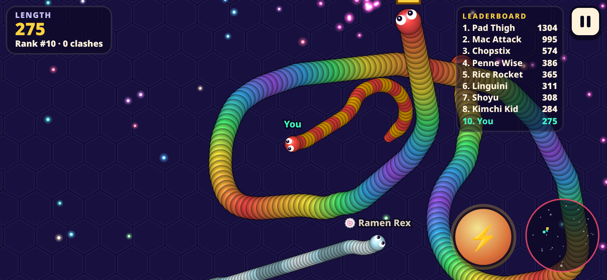
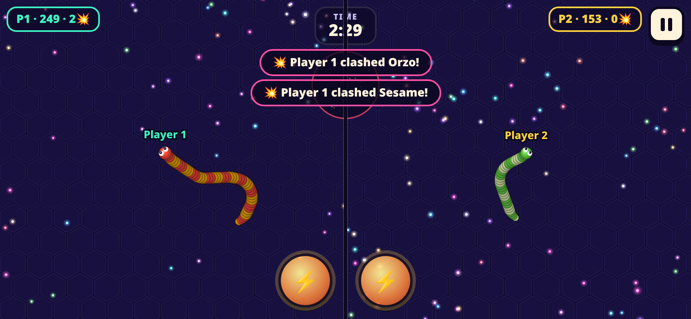
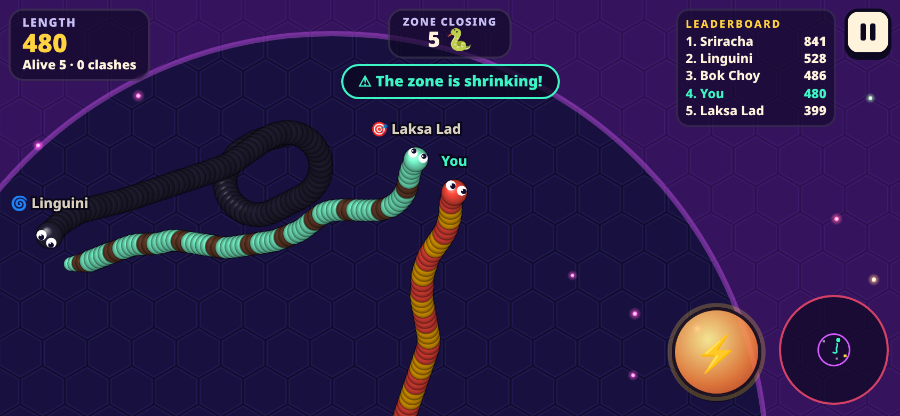
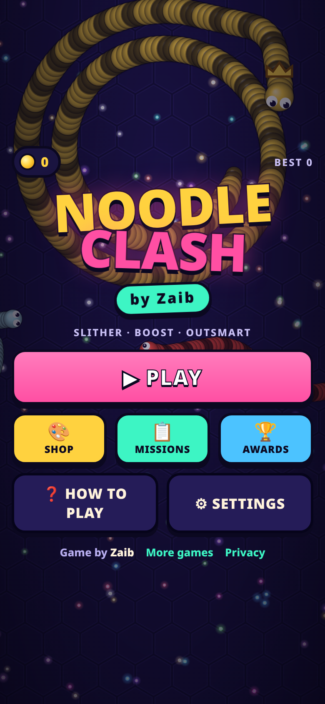
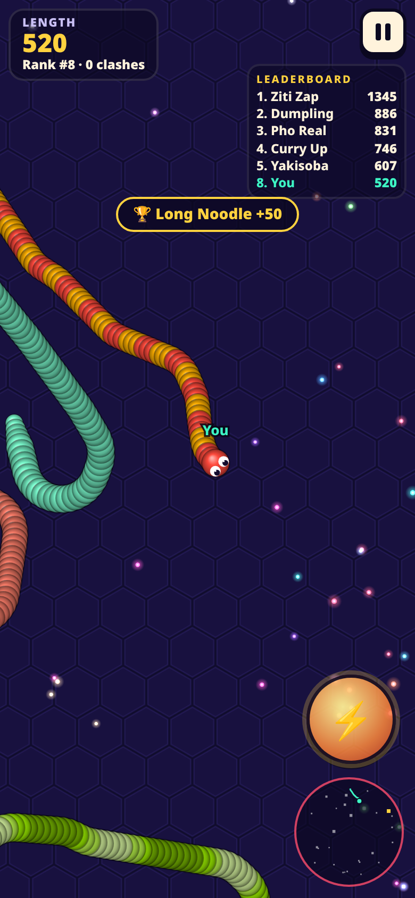

# Noodle Clash by Zaib

Noodle Clash is a snake battle arena game for mobile and desktop browsers. Slither around a neon arena, eat glowing orbs to grow, boost to cut off your rivals, and make other snakes crash into your body. It runs fully offline against AI snakes, and there is no server.

**Play:** https://zaibgames.com/noodle-clash/

 
 

## Features
- **4 modes**
  - **Classic:** an endless arena. Grow huge and take the crown.
  - **Rush:** 3 minutes with double the orbs and instant respawns. Be the longest when time runs out.
  - **Battle Royale:** 18 snakes, no respawns and a shrinking zone. Outside the zone you drain length fast. The last snake left wins.
  - **Duo:** 2 players share one phone in landscape split screen for a 3-minute duel against each other and the AI.
- **Smart AI with personalities**
  - 🎯 **Hunters** chase heads, aim ahead of their target and cut across its path.
  - 💨 **Cowards** flee from bigger snakes.
  - 🌀 **Encirclers** coil around smaller prey and tighten the loop.
  - 🍥 **Grazers** go after the richest food and boost to fresh remains.
  - Every AI uses ray-sampled obstacle avoidance and predicts where other heads are going. Skill varies from snake to snake.
- **Slither-style physics:** smooth path-following bodies. Boosting burns length and drops orbs behind you. Crashed snakes explode into big glowing orbs. A snake grows thicker as it grows longer, and bigger snakes turn wider. Big snakes spawn coiled up.
- **Live leaderboard** with a crown on the leader, plus a **minimap** that shows your body, rivals, the leader and the zone.
- **Shop:** 18 colour skins and 8 patterns (Smooth, Stripes, Rings, Zebra, Polka Dots, Spine Lights, Color Flow and an animated Neon Pulse), bought with coins and shown in a live preview.
- **Daily missions:** 3 new missions every day, each with a coin reward. There are also **19 achievements**.
- **Tutorial:** an interactive 4-step tutorial on first play, a How to Play screen, and settings for sound, music, vibration, steering mode, left-handed layout, graphics quality and name tags.
- **Performance:** a counting-sort spatial hash for body segments and orbs, rebuilt every frame. Segment and orb sprites are cached, the game uses delta-time with sub-steps, and it switches to low quality automatically when the frame rate drops. It pauses when the tab is hidden.
- **Audio:** all music and sound effects are synthesized with WebAudio and pass through a master limiter. Only tonal oscillators are used (no noise sources).

## Controls
| Action | Touch | Keyboard / mouse |
|---|---|---|
| Steer | Floating joystick (drag anywhere), or **Follow finger** mode in Settings | Point with the mouse, or ← → / A D |
| Boost | Hold the ⚡ button, or tap with a second finger | Hold the mouse button, Space, ↑ or W |
| Pause | II button | P / Esc |
| Duo P1 | Left half: joystick + ⚡ | A / D to turn, W / Shift to boost |
| Duo P2 | Right half: joystick + ⚡ | ← / → to turn, ↑ / Enter to boost |

## Tech
- One self-contained `index.html` (Canvas 2D + vanilla JS) with no external libraries or assets.
- Mobile-first: fullscreen, works in portrait and landscape (Duo needs landscape), supports multi-touch, respects safe-area insets, and blocks scrolling and zooming.
- Progress is saved in `localStorage`.

Game by **Zaib** · [More games](https://zaibgames.com/) · [Privacy](https://zaibgames.com/privacy/)
